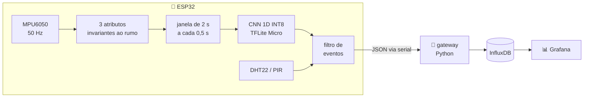

<div align="center">

# 🚗 Telemetria veicular com TinyML no ESP32

**Detecção de manobras de direção _dentro_ do microcontrolador, com uma CNN 1D quantizada em INT8 no TensorFlow Lite Micro.**


| 🎯 Manobras detectadas | ✅ Classe certa | 📦 Modelo INT8 | 🧠 Arena TFLM | 🔁 INT8 = FP32 |
|:---:|:---:|:---:|:---:|:---:|
| **93%** | **98%** | **10,5 KB** | **5,2 KB** | **98% das decisões** |

</div>

---

O ESP32 lê o IMU a 50 Hz, roda a rede a cada 0,5 s e envia apenas **eventos** (frenagem brusca, aceleração brusca, curva, troca de faixa), e não o fluxo bruto dos sensores: menos tráfego, menos latência e funcionamento sem internet.

Sensores: **MPU6050** (acelerômetro e giroscópio, entrada do modelo), **DHT22** (temperatura e umidade da cabine) e **PIR** (presença na cabine com o veículo parado).

## Sumário

- [Arquitetura](#arquitetura)
- [Resultados](#resultados)
- [Decisões técnicas](#decisões-técnicas)
- [Verificação do firmware](#verificação-do-firmware)
- [Limitações](#limitações)
- [Próximos passos](#próximos-passos)
- [Como rodar](#como-rodar)
- [Estrutura](#estrutura)
- [Créditos](#créditos)

## Arquitetura



Cada manobra vira uma linha JSON na serial:

```text
{"tipo":"evento","t_ms":81250,"evento":"freada_brusca","confianca":0.97,"latencia_us":<µs>,"temp_c":27.4,"umidade":61.0,"presenca":false}
```

> Os valores acima ilustram o formato; `latencia_us` é o tempo da inferência medido na placa. Classes do modelo: `normal`, `curva_esquerda`, `curva_direita`, `troca_faixa` e `longitudinal`, que o firmware separa em `freada_brusca` ou `aceleracao_brusca` pelo sinal do eixo X.

## Resultados

Dados: [Driver Behavior Dataset](https://github.com/jair-jr/driverBehaviorDataset), com acelerômetro e giroscópio gravados num Honda Civic em 4 viagens (cerca de 51 minutos), com 69 manobras rotuladas por vídeo.

### Quantização: FP32 vs INT8

Validação cruzada em 5 partes **agrupada por evento**: janelas da mesma manobra nunca ficam no treino e no teste ao mesmo tempo. O mesmo modelo é avaliado nas duas precisões.

| Canais de entrada | F1 FP32 | F1 INT8 | Mesma decisão INT8 vs FP32 |
|---|---|---|---|
| 3 canais (usado no ESP32) | 0,929 ± 0,037 | 0,933 ± 0,046 | 98,0% |
| 4 canais (com aceleração vertical) | 0,962 ± 0,017 | 0,961 ± 0,017 | 99,8% |

| Recurso | FP32 | INT8 |
|---|---|---|
| Parâmetros | 1.653 | 1.653 |
| Memória dos pesos | 6,6 KB | 1,8 KB (3,7× menor) |
| Arquivo `.tflite` | 13,5 KB | 10,5 KB (1,3× menor) |
| Memória de trabalho no TFLite Micro (arena) | — | 5,2 KB |
| Latência no PC (x86, mediana) | 4 µs | 8 µs |
| **Latência no ESP32** | — | **a medir no dispositivo** |

Os pesos ficam 3,7× menores, mas o arquivo só 1,3×: num modelo deste tamanho, a estrutura fixa do formato TFLite pesa mais que os pesos. No PC, o INT8 é mais lento porque o x86 tem instruções de ponto flutuante muito otimizadas; o ganho de velocidade do INT8 aparece em microcontroladores e aceleradores.

### Avaliação contínua, viagem por viagem

A métrica que importa no carro: treina-se o modelo **sem** uma viagem, e ele roda nela de ponta a ponta, como no ESP32 (janela de 2 s a cada 0,5 s, com o filtro de eventos). Repete-se para as 4 viagens (`src/evaluate_stream.py`).

| Limiar de confiança | Manobras detectadas | Classe certa | Alarmes falsos |
|---|---|---|---|
| 0,70 | 98% | 100% | 1,82/min |
| **0,85 (firmware)** | **93%** | **98%** | **1,37/min** |
| 0,95 | 91% | 98% | 1,15/min |
| 0,99 | 82% | 100% | 0,88/min |

"Alarme falso" aqui é qualquer evento fora das manobras rotuladas, uma medida conservadora (ver Limitações).

## Decisões técnicas

- **Atributos que não dependem do rumo.** O dataset está no referencial da Terra (leste, norte, cima), e não no do carro. Uso a magnitude da aceleração horizontal, a guinada (giroscópio z) e a magnitude da rotação horizontal. No ESP32 isso tem uma vantagem prática: basta a placa estar deitada, em qualquer giro.
- **Frenagem e aceleração formam uma classe só ("longitudinal").** Sem o rumo, as duas manobras têm a mesma magnitude. No ESP32, com o eixo X do MPU6050 apontado para a frente, o sinal da aceleração separa as duas.
- **3 canais em vez de 4.** A aceleração vertical do dataset aparece alta nas curvas, provavelmente um artefato do cálculo de orientação do celular, que o MPU6050 não reproduziria. Troquei cerca de 3 pontos de F1 por robustez no hardware real.
- **Aumento de dados físico.** Inverter o sinal da guinada transforma uma curva à esquerda numa curva à direita. Isso dobra os exemplos de curva sem inventar dados.
- **Quantização inteira completa (PTQ).** Pesos, ativações, entrada e saída em INT8, com calibração por dados reais (`representative_dataset`), porque é o que o microcontrolador executa com eficiência.
- **Quantização por tensor na camada densa.** O TFLite Micro ainda não suporta quantização por canal em `FULLY_CONNECTED`. O teste do firmware compilado no PC pegou esse erro antes de chegar à placa.
- **Filtro de eventos.** Exige 2 previsões iguais seguidas acima do limiar, emite um evento por manobra e mantém intervalo mínimo entre eventos. Assim, uma frenagem de 3 s gera um evento, e não seis.
- **Regra física testada e descartada.** Testei um limiar de intensidade (cerca de 0,3 g) para filtrar eventos longitudinais. Os "alarmes falsos" tinham pico mediano de 3,5 m/s², contra 4,1 m/s² das manobras rotuladas, então a regra cortaria manobras reais sem resolver o problema.

## Verificação do firmware

O código C++ do firmware (`imu_features.h`, `classifier.h`, `model_data.h`) é compilado no PC junto com o código-fonte do TensorFlow Lite Micro da biblioteca `tflm_esp32`, e comparado com o Python (`tests/test_firmware.py`):

- atributos iguais aos do Python;
- **mesma classe em 100% das janelas** em relação ao interpretador TFLite com kernels de referência.

Contra o interpretador padrão do Python, a concordância é de 99,7%: o acelerador XNNPACK arredonda as contas inteiras de um jeito ligeiramente diferente. No ESP32, os kernels otimizados ESP-NN também podem causar diferenças pequenas desse tipo.

## Limitações

- **Dataset pequeno:** 69 manobras, 2 motoristas, 1 carro e 1 celular. Os números acima são otimistas para outros veículos e motoristas.
- **Rótulos incompletos:** só as manobras do roteiro foram rotuladas. As freadas e acelerações feitas entre um teste e outro contam como alarme falso, mesmo quando são manobras fortes de verdade.
- **Sensor diferente:** o modelo foi treinado com dados de celular e roda no MPU6050. A validação no hardware real é o próximo passo.

## Próximos passos

1. Medir a latência e o consumo de memória no ESP32.
2. Gravar e rotular uma viagem completa com o MPU6050, para validar no sensor real e ajustar o modelo com esses dados.
3. Enviar os eventos por BLE ou MQTT, em vez da serial.

## Como rodar

### Treino e avaliação (PC)

```bash
python -m venv .venv && source .venv/bin/activate
pip install -r requirements.txt
bash data/download_dataset.sh

python src/prepare_data.py                          # janelas rotuladas
python src/train.py --channels a_h,g_z,g_h          # validação cruzada, modelo final e firmware/model_data.h
python src/evaluate_stream.py --thresholds 0.85,0.7,0.95,0.99
pytest -q tests                                      # testes de Python
```

Testes do firmware compilado no PC (precisa da biblioteca `tflm_esp32`):

```bash
git clone --depth 1 https://github.com/eloquentarduino/tflm_esp32.git ../tflm_esp32
TFLM_SRC=../tflm_esp32/src pytest -q tests/test_firmware.py
```

### ESP32 (Arduino IDE)

1. Instale o suporte ao ESP32 e as bibliotecas **tflm_esp32**, **Adafruit MPU6050** e **DHT sensor library**.
2. Ligações (ESP32 DevKit V1):

   | Sensor | Pinos |
   |---|---|
   | MPU6050 | VCC 3V3, GND, SDA GPIO21, SCL GPIO22 |
   | DHT22 | VCC 3V3, GND, DATA GPIO4 |
   | PIR | VCC VIN (5 V), GND, OUT GPIO27 |

3. Monte o MPU6050 deitado, com o chip para cima e o eixo X para a frente do veículo.
4. Abra `firmware/telemetria_tinyml/telemetria_tinyml.ino` e grave. Na inicialização, deixe parado por 2 s para a calibração.
5. No Monitor Serial (115200), a primeira linha mostra o tamanho do modelo e a memória usada. Cada evento traz a latência da inferência em `latencia_us`.

### Gateway e Grafana

```bash
docker compose up -d                                 # InfluxDB + Grafana em http://localhost:3000
python gateway/gateway.py --port /dev/ttyUSB0 \
  --influx-url http://localhost:8086 --influx-token tinyml-token-local
```

Sem hardware, o simulador reproduz uma viagem do dataset com o mesmo modelo e o mesmo filtro do firmware:

```bash
python gateway/simulate.py --trip 21 | python gateway/gateway.py --stdin \
  --influx-url http://localhost:8086 --influx-token tinyml-token-local
```

Consultas Flux para os painéis do Grafana:

```flux
// Eventos por tipo
from(bucket: "telemetria") |> range(start: v.timeRangeStart, stop: v.timeRangeStop)
  |> filter(fn: (r) => r._measurement == "evento" and r._field == "contagem")
  |> group(columns: ["evento"]) |> sum()

// Latência da inferência no ESP32
from(bucket: "telemetria") |> range(start: v.timeRangeStart, stop: v.timeRangeStop)
  |> filter(fn: (r) => r._measurement == "evento" and r._field == "latencia_us")

// Temperatura da cabine
from(bucket: "telemetria") |> range(start: v.timeRangeStart, stop: v.timeRangeStop)
  |> filter(fn: (r) => r._measurement == "telemetria" and r._field == "temp_c")
```

## Estrutura

```
src/                 dados, treino, quantização e avaliação
firmware/            sketch do ESP32 (TFLite Micro) e modelo em C (gerado)
gateway/             leitura serial -> CSV/InfluxDB, e simulador sem hardware
tests/               pytest, e o firmware compilado no PC (tests/host)
artifacts/           modelos .tflite e relatórios de avaliação
```

## Créditos

Dataset: J. Ferreira Júnior, E. Carvalho, B. V. Ferreira, C. de Souza, Y. Suhara, A. Pentland e G. Pessin, "Driver behavior profiling: An investigation with different smartphone sensors and machine learning", *PLOS ONE*, 2017.
